<div align="center">

# Vault

**A personal command centre for notes, projects, jobs and your calendar — stored in your own Google Drive.**

[](./LICENSE)
[](https://nextjs.org)
[](https://www.typescriptlang.org)
[](#self-hosting)

[Features](#features) · [How your data is stored](#how-your-data-is-stored) · [Quick start](#quick-start) · [Self-hosting](#self-hosting) · [Troubleshooting](#troubleshooting)

</div>

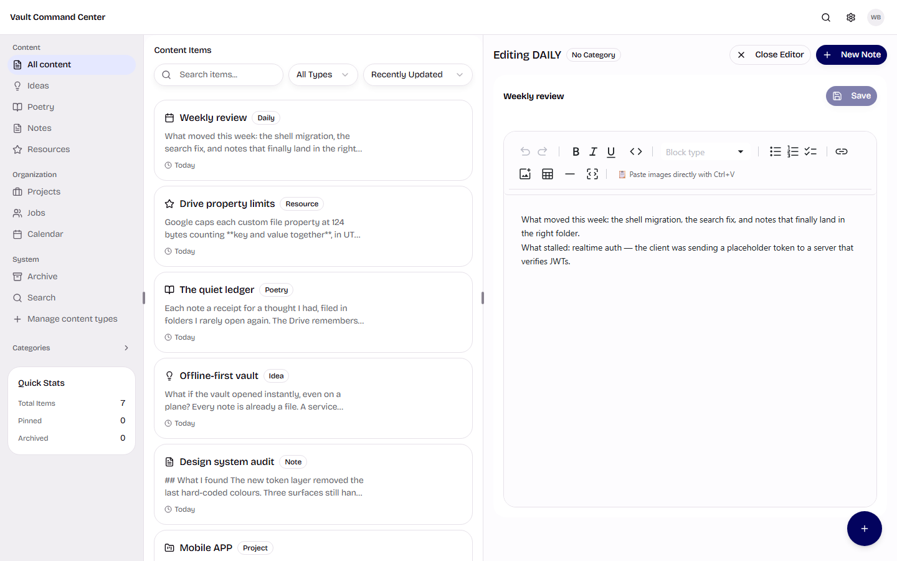

---

## Screenshots

| | |
|---|---|
| **Dashboard** — notes list beside the editor, with the navigation rail, categories and quick stats | **Calendar** — month view with events stored as JSON sidecars in Drive |
|  | 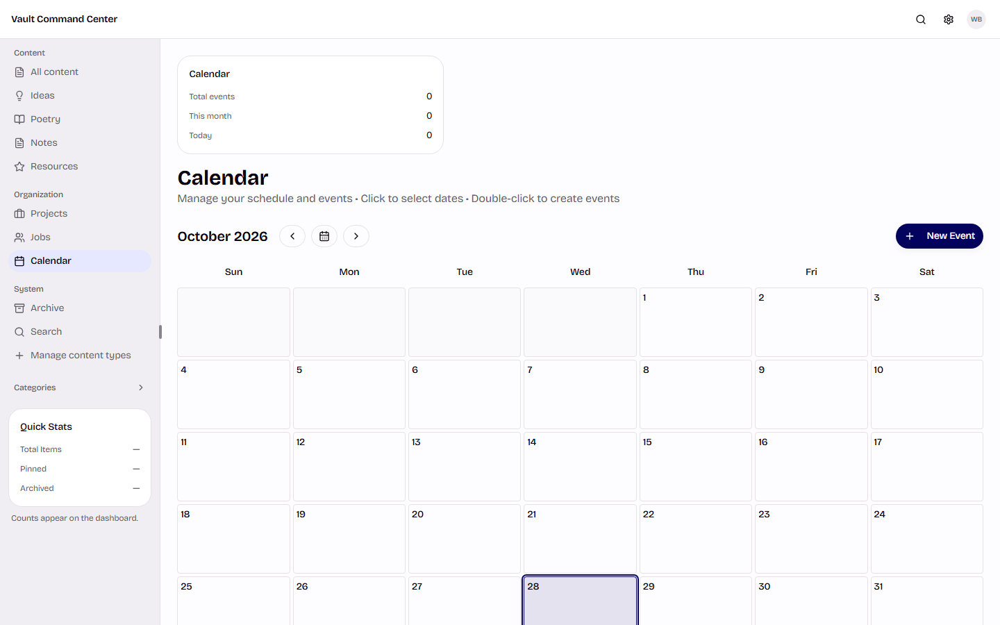 |
| **Jobs** — application pipeline with stage counters and progress | **Projects** — project cards with status, priority, dates and progress |
| 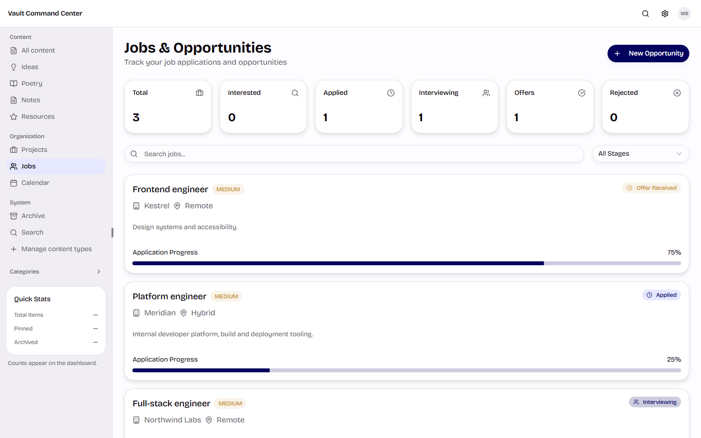 | 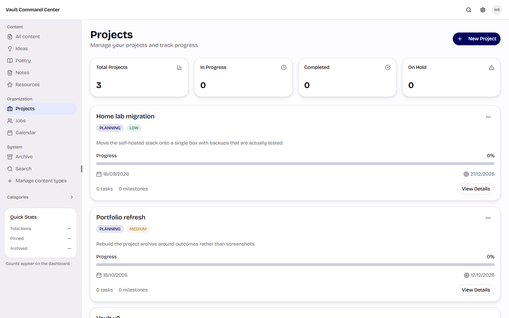 |
| **Search** — one query across notes, projects, jobs and events | **Files** — uploads and provider filtering |
| 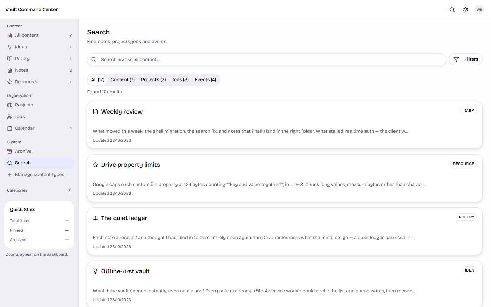 | 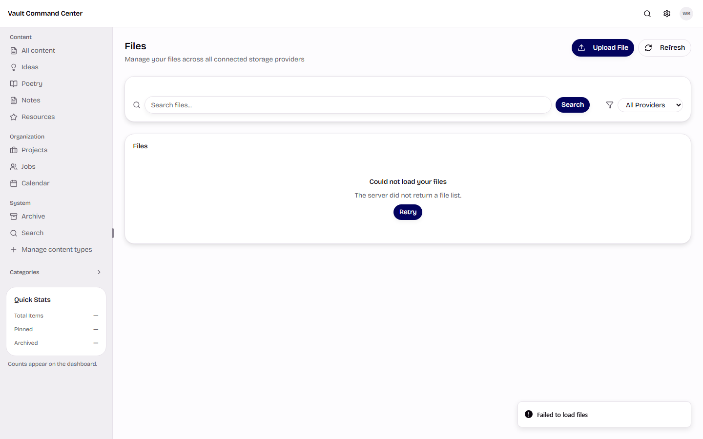 |
| **Cloud storage** — a single Google Drive connection, status and setup | **Content types** — system types and your own custom ones |
| 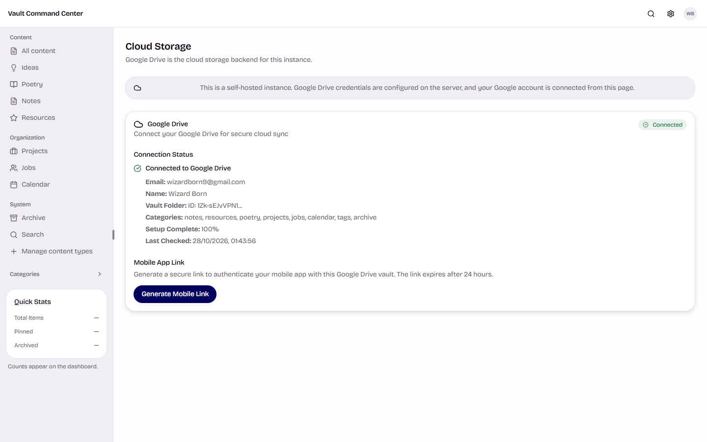 | 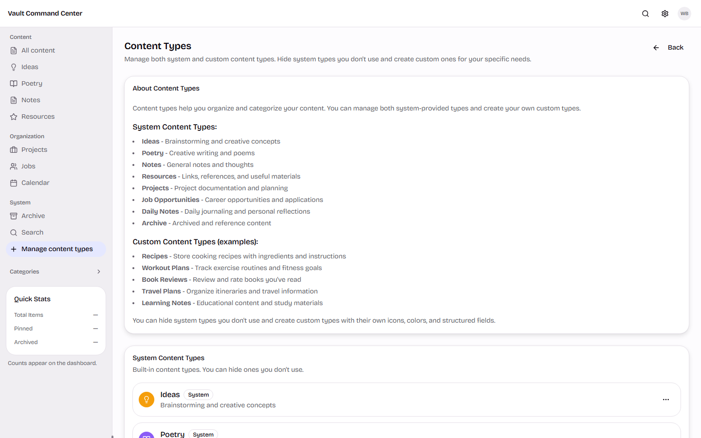 |

<details>
<summary>More screenshots — data, integrations, sign-in and error states</summary>

| | |
|---|---|
| **Data** — export and backup controls | **Integrations** — the connected Drive account |
| 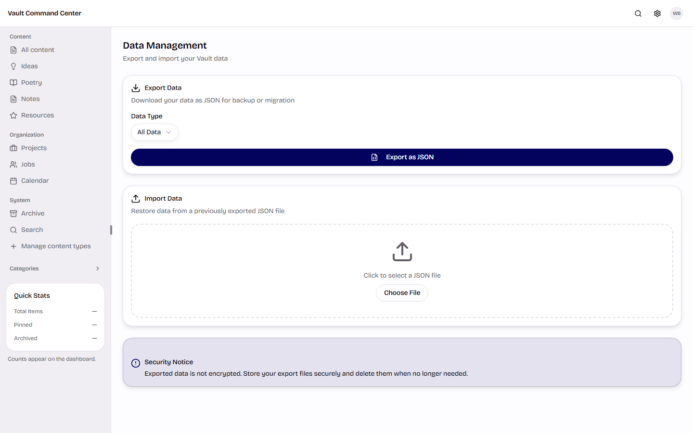 | 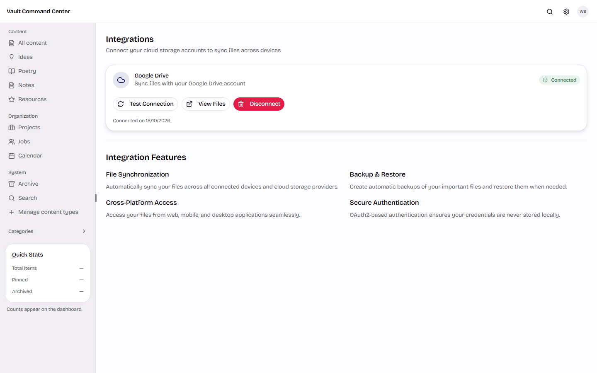 |
| **Calendar integrations** — import and export | **Sign in** — Google only, no password field |
| 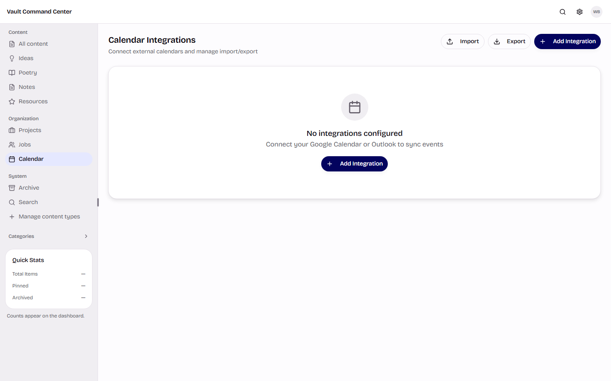 | 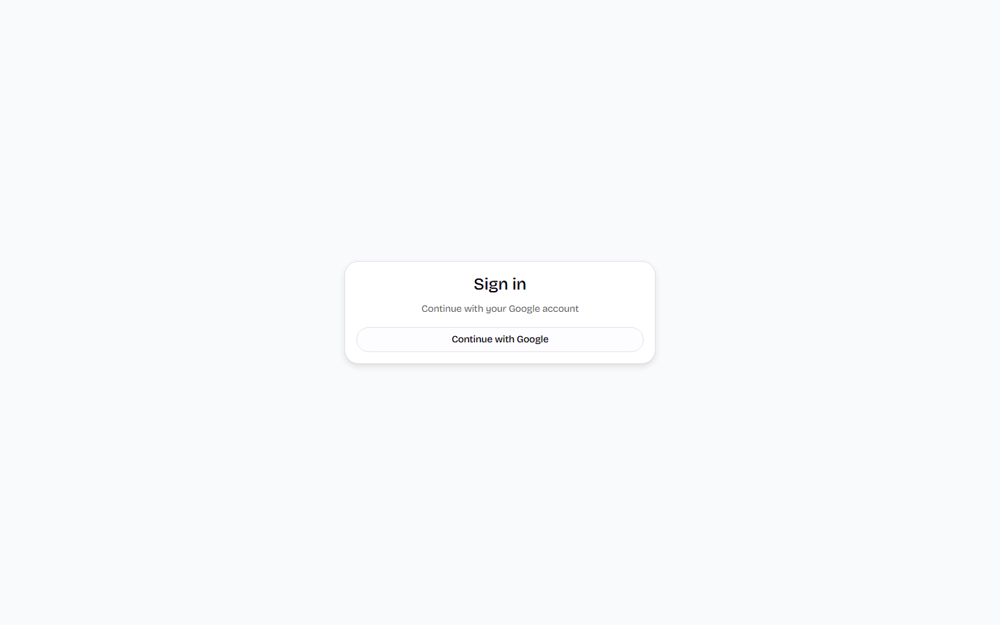 |
| **Error page** — a signed-out or failed sign-in, explained | |
| 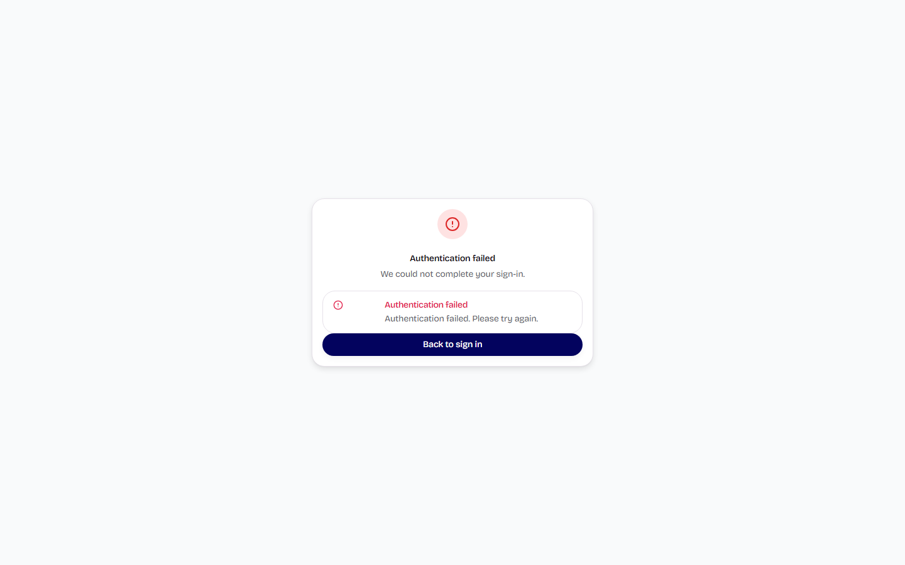 | |

</details>

---

## What this is

Vault is a self-hosted personal information manager. You sign in with Google, and everything you write —
notes, ideas, poetry, projects, job applications and calendar events — is saved as **plain files inside
your own Google Drive**. There is no vendor account, no proprietary database of your content, and nothing
to export if you leave: your notes are already files you own.

The app is a Next.js application with a small SQLite database that holds only what it must — your user
record, the link to your Google account, and preferences. The content itself never touches the server's
disk.

It is built for one person managing their own work. It is not a multi-tenant SaaS.

## Features

- **Notes, ideas, poetry, resources** — markdown files with frontmatter, organised into category folders.
- **Projects** — with tasks, milestones, progress and status.
- **Job applications** — stages, priorities, deadlines, and a board view.
- **Calendar** — month view, events stored as JSON sidecars next to your notes.
- **Search** across everything you own.
- **Your Drive is the source of truth** — edit a file in Drive and the app reflects it.
- **Real-time sync** between open tabs, over a bundled Socket.IO server.
- **Resizable, keyboard-accessible interface** with light and dark themes.
- **Google sign-in only.** No passwords, no email verification, no account database to secure.

## How your data is stored

```
My Drive/
└── Vault/
    ├── Ideas/
    │   └── God's Eye View_2026-10-27.md      ← markdown + YAML frontmatter
    ├── Notes/
    ├── Poetry/
    ├── Projects/
    ├── Jobs/
    │   └── Acme — Backend_2026-10-20.job.json
    ├── Calendar/
    │   └── Standup_2026-10-28.event.json
    ├── Resources/
    ├── Daily/
    ├── Archive/
    └── Tags/
        └── _category.json                     ← optional folder metadata
```

- A **note** is a `.md` file: YAML frontmatter (title, type, status, tags, timestamps) then the body.
- A **job** and an **event** are JSON sidecars, so they round-trip without parsing prose.
- A **category** is a folder. The folder is chosen by category — or, when you don't pick one, by the
  note's type (`Idea` → `Ideas`).
- The app caches *metadata* briefly to keep lists fast, but the **body is always read from the file**, and
  deleting a file in Drive deletes the note.

## Quick start

### Prerequisites

- Node.js 20 or newer
- A Google account
- A Google Cloud project with an OAuth client (below)

### 1. Google OAuth

1. Open the [Google Cloud console](https://console.cloud.google.com/) and create (or pick) a project.
2. **APIs & Services → Library → Google Drive API → Enable.**
3. **APIs & Services → OAuth consent screen** — choose *External*, fill in the app name and support email.
   Add the scope `.../auth/drive.file` (Vault only needs files it creates).
4. **Publish the app.** While the consent screen is in *Testing*, Google expires refresh tokens after
   seven days and Vault will lose its Drive connection weekly. This is the single most common setup mistake.
5. **Credentials → Create credentials → OAuth client ID → Web application.**
6. Add the authorised redirect URI for the exact origin you will run on:
   `<your origin>/api/auth/callback/google` — e.g. `http://localhost:3000/api/auth/callback/google`.

### 2. Configure

```bash
git clone https://github.com/<you>/vault.git
cd vault
cp .env.example .env
```

Fill in `.env`. At minimum:

```env
DATABASE_URL="file:./prisma/db/custom.db"
NEXTAUTH_URL="http://localhost:3000"
NEXTAUTH_SECRET="<openssl rand -base64 32>"
GOOGLE_CLIENT_ID="<from the Google console>"
GOOGLE_CLIENT_SECRET="<from the Google console>"
NEXT_PUBLIC_CUSTOM_SERVER="true"
```

### 3. Install and run

```bash
npm install
npm run db:push        # create the SQLite schema
npm run dev            # http://localhost:3000
```

`npm run dev` starts the custom server, which is what serves both Next.js and the Socket.IO endpoint.
Sign in with Google and Vault creates `Vault/` and its folders in your Drive on first use.

## Self-hosting

Vault needs a **persistent container host** — not a serverless platform. It runs a custom Node server
(Socket.IO + websockets) and keeps a SQLite file on disk.

### Docker

```bash
cp .env.example .env    # fill it in
docker compose up --build -d
```

Two things matter for anything beyond a test:

**Mount a volume for the database.** It holds your user record and the link to your Google account. If the
volume is lost on redeploy, you will have to reconnect Drive and lose your preferences. The bundled
`docker-compose.yml` mounts one at `/app/data` — keep it.

**Build with production values.** `NEXT_PUBLIC_*` variables are inlined at build time. Building with
`localhost` and deploying that image produces an app that tells the browser to connect to `localhost`. The
Dockerfile accepts them as build arguments for this reason.

### Behind a reverse proxy

Terminate TLS in front of the container and set `NEXTAUTH_URL` to the public **https** origin. The Google
redirect URI must match that origin exactly. Vault will then use `__Secure-` prefixed session cookies,
which is expected.

### Configuration reference

| Variable | Required | Purpose |
| --- | --- | --- |
| `DATABASE_URL` | yes | SQLite file URL. Keep it inside the mounted volume. |
| `NEXTAUTH_URL` | yes | Public origin. Must match the Google redirect URI. |
| `NEXTAUTH_SECRET` | yes | Signs session cookies and socket tokens. The app refuses to start without it. |
| `GOOGLE_CLIENT_ID` | yes | OAuth client id. |
| `GOOGLE_CLIENT_SECRET` | yes | OAuth client secret. |
| `NEXT_PUBLIC_CUSTOM_SERVER` | yes for realtime | `true` when running the bundled custom server (`npm run start:prod` / Docker). |
| `NEXT_PUBLIC_SOCKET_URL` | no | Socket origin if it differs from the page origin. |
| `GOOGLE_REDIRECT_URI` | no | Overrides the computed OAuth callback. |
| `PORT` | no | Defaults to `3000`. |

Secrets belong in your host's environment settings, never in the repository.

### Scripts

| Script | Purpose |
| --- | --- |
| `npm run dev` | Custom server with reload — the normal development loop. |
| `npm run build` | Production build. Inlines `NEXT_PUBLIC_*`. |
| `npm run start:prod` | Serves the production build with Socket.IO. |
| `npm test` | Vitest suite. |
| `npm run type-check` | `tsc --noEmit`. |
| `npm run db:push` | Applies the Prisma schema to the SQLite file. |
| `npm run db:seed` | Inserts a demo user for local testing. |

## Troubleshooting

**"Google Drive not connected" everywhere.** The row linking your account is missing or its tokens were
revoked. Reconnect from **Settings → Cloud Storage**. If it recurs weekly, your OAuth app is still in
Testing mode.

**`invalid_grant` in the server log.** Google rejected the refresh token. Same cause as above — publish
the OAuth app, then reconnect.

**Changes do not appear after editing source.** The running server serves a built `.next` directory.
Rebuild and restart; a stale build will keep serving old code.

**"no such table" on a fresh container.** The schema was never applied. `npm run db:push` locally, or let
the bundled image do it at startup.

**Signed out / Drive disconnected after a redeploy.** The database volume was not persistent.

**Redirect URI mismatch from Google.** `NEXTAUTH_URL` and the URI registered in the Google console must be
the same origin, including scheme and port.

**Realtime does not connect.** `NEXT_PUBLIC_CUSTOM_SERVER` must be `true` at build time, and the app must
be served by the custom server rather than `next start`.

## Known limitations

- The **mobile client is not part of this repository's published scope**.
- Realtime requires the bundled custom server; a plain `next start` has no websocket endpoint.
- Vault is designed for one person's Drive. There is no sharing, no team workspace and no collaborative
  editing — the socket server syncs your own tabs.
- Because Drive is the source of truth, files edited outside the app keep their content but may not carry
  the metadata Vault expects.

## Security and permissions

Vault requests the `drive.file` scope, which grants access only to files the app itself creates — not your
entire Drive. Sessions are httpOnly cookies, socket connections authenticate from that cookie, and the app
refuses to boot without `NEXTAUTH_SECRET` rather than falling back to a known value.

Self-hosting means you are responsible for your own instance: keep it patched, keep the volume backed up,
and treat your Google OAuth credentials as secrets.

## Project structure

```
src/
  app/            routes, the authenticated shell, API handlers
  components/     UI — shell, panes, primitives, feature surfaces
  lib/            Drive adapters, availability gate, error contracts
  hooks/          data and socket hooks
prisma/           schema and the local SQLite file
server.ts         custom Next.js + Socket.IO server
docs/             supporting documentation
```

## Contributing

Issues and pull requests are welcome. Please run `npm run type-check` and `npm test` before opening a PR,
and keep changes focused — this codebase values small, verifiable diffs over large rewrites.

## License

[MIT](./LICENSE). Use it, fork it, self-host it.
